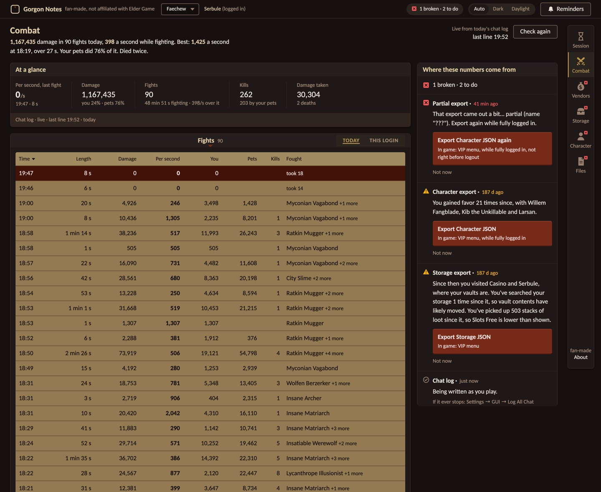
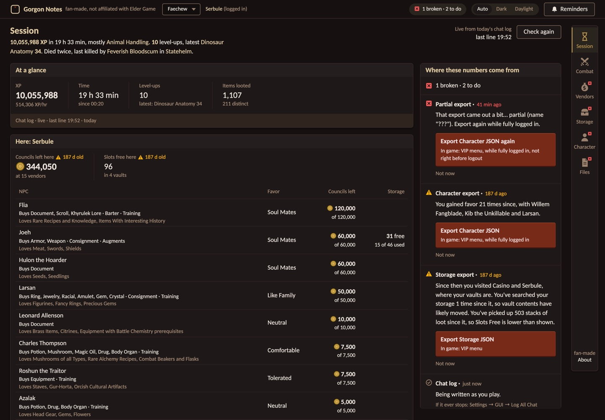
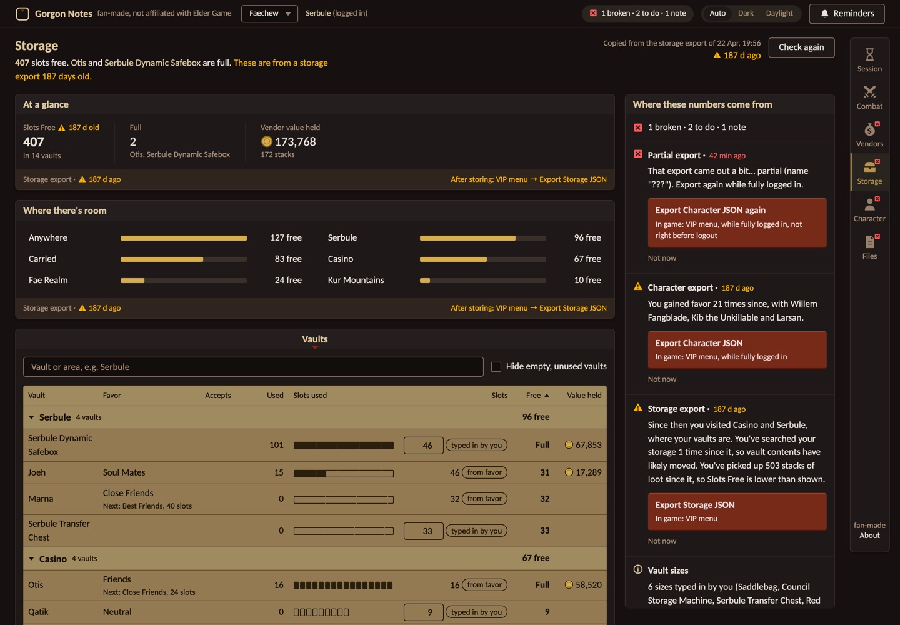

# Gorgon Notes

A personal dashboard for **Project: Gorgon**, built from the files the game already writes on your computer: the VIP menu's character and storage exports, the chat log, and the public game data CDN. It runs on your own machine, reads the game folder, and never sends anything about your character anywhere unless you ask it to (party sharing and Discord posts are opt-in).

Fan-made, not affiliated with Elder Game. MIT licensed. Source and releases: https://github.com/robaxelsen/gorgon-notes



## What it does

Every number in the app says where it came from, how old it is, and the exact in-game step that would make it current. That is the one rule the whole thing is built on.

- **Combat**: a personal DPS meter from the chat log, live while you play. Damage per second now, damage today split between you and your pets, every fight with its length, damage, kills and what you fought, and a breakdown of any fight by ability, by enemy (you, pets and damage over time per enemy, to check against the game's autopsy) and with a damage-a-second chart. Damage over time is counted from your own log. Party members' hits never appear in your log, so the **Party** window shares fights instead: one of you makes a code, the others join it, and everyone's fights line up side by side, with a live per-second line while you fight and a session table (one row per player and pet) by area or by a session you start and stop yourself.
- **Discord**: Connect Discord once from the Party window (Discord's own server and channel picker, no webhook to copy) and post a fight or a whole session to a channel as a card with a picture of the table.
- **Session**: XP per skill and per hour, level-ups, loot with icons, councils in and out, deaths and kills, what happened when, the chat log with channel colours, and **Here**: the NPCs where you are standing with favor, councils left to spend, storage and what they love as gifts.
- **Vendors**: councils left at every vendor, how much you have drained, resets since your export, where to sell and who buys what, and a **Sell** plan for your bags: the books, documents and scrolls to sell, to whom and for about how much, stop by stop, and the gear with its prices as your call. Nothing else is treated as trash; a Sell or Keep mark per item type is remembered.
- **Storage**: slots free per vault, where there is room, and every item you hold. Stacks to merge finds the same item held in several places.
- **Character**: skills, currencies, stats, NPC favor and active quests with readable names, from any export, partial ones labelled.
- **Files**: every file the app reads, with a JSON tree and search for the exports and the cached game data, and a pager and search for the chat logs.
- **Teleports**: every Teleportation Machine code from the wiki's player-kept list, one window per zone with the zone you are in first, a search over zones, landmarks and codes, and a click to copy a code; each window says when the page was fetched and when the wiki last confirmed the numbers.
- **Reminders**: opt-in notifications at the moments that matter: logging in, arriving where your vaults are, after selling, when an export is broken or stale, when vendors reset. Native notifications in the Mac app.





## Install

### Windows

1. Download `GorgonNotes.exe` from the [latest release](https://github.com/robaxelsen/gorgon-notes/releases/latest).
2. Double-click it. If Windows says "Windows protected your PC", click "More info", then "Run anyway". That happens once because the file was downloaded; nothing is installed and nothing is signed yet.
3. The Gorgon Notes window opens. The first start takes a few seconds longer while it unpacks itself into `C:\Users\<you>\AppData\Local\Gorgon Notes\app`, and the first page can take ten seconds while it reads your chat logs.

The exe keeps itself current: at every start it asks GitHub for the newest release and fetches it before opening. Close the window to stop. To remove it, delete the exe and that folder. If the exe is blocked, the `GorgonNotes-windows.zip` from the same release does the same from an extracted folder via `Gorgon Notes.bat`. Nothing else needs installing; the download carries its own Python.

If the About window ever says the server behind it is an older version, close every Gorgon Notes window and start it once more. That happens when an update lands while an earlier window was still open.

### Mac

Python 3.9 or newer, which macOS does not ship; `brew install python` or python.org works.

```bash
git clone https://github.com/robaxelsen/gorgon-notes.git
cd gorgon-notes
python3 server.py --open      # serves http://127.0.0.1:8787 and opens it
```

Two optional layers on top:

- **Menu-bar app** (`Gorgon Notes.app`): a scroll icon that turns amber or red with a count when something needs doing, a menu with each problem and its fix, the app in its own window, native notifications. Needs the Xcode command line tools for `swiftc`. Build and install with `mac/build.sh install`; the first build takes a few minutes. It uses whatever server answers on port 8787 and starts `server.py` itself otherwise.
- **Server at login**: `mac/local.gorgon-notes.server.plist` is a launchd agent. Edit its two paths (the Python binary and the repo folder), then:

  ```bash
  cp mac/local.gorgon-notes.server.plist ~/Library/LaunchAgents/
  launchctl bootstrap gui/$(id -u) ~/Library/LaunchAgents/local.gorgon-notes.server.plist
  ```

  Restart it after pulling a new version with `launchctl kickstart -k gui/$(id -u)/local.gorgon-notes.server`. Its log is `/tmp/gorgon-notes.log`.

### Anywhere else

`python3 server.py` is all it takes. The game folder is found per OS (Mac `~/Library/Application Support/unity.Elder Game.Project Gorgon`, Windows `%USERPROFILE%\AppData\LocalLow\Elder Game\Project Gorgon`); on Linux under Proton point `PG_DIR` at that `LocalLow` folder inside the game's prefix. Startup prints the folder it found and how many exports and chat logs it holds. Other settings: `PG_PORT` (default 8787), `PG_PLAYER_LOG`, `PG_ROOM` (another party room, empty for ntfy.sh only), `PG_NTFY`.

## In the game

- **Exports**: VIP menu → **Export Character JSON** and **Export Storage JSON**. They land in the game's `Reports` folder and the app reads them there. Export storage again after a big sorting session; the app tells you when it is time.
- **Chat log**: Settings → GUI → **Log All Chat**. The Session and Combat views come from it, live. Without it the app still shows everything the exports hold.
- **VIP auto-export**: the VIP settings can save the character automatically on logout and area changes. The app notices those files too.

## Playing with friends

Each party member runs Gorgon Notes with chat logging on, since each log only holds its owner's hits. Before fighting, one of you presses **New code** in the Party window and pastes the code into party chat; the others paste it into the code field and press **Join**. Fights are shared through a small Cloudflare Worker (`cloud/`, no account, no secrets, only fight numbers and character names) and merged by time and by the party the chat log names. Press **Start session** before a dungeon run, **Stop session** after, and **Post session to Discord** for one report of the whole run. Windows copies of the friends update themselves, so one release serves everyone.

## How it is built

A Python standard-library server (`server.py`) plus one HTML page with vanilla JavaScript and CSS (`static/`). No dependencies, no build step, nothing to install for development beyond Python. The Windows exe is a small Go launcher that embeds the app and the python.org embeddable Python; the Mac app is one Swift file around a web view.

| Path | What |
|---|---|
| `server.py` | JSON API and static server: parses chat logs, reads exports, fetches and caches game data |
| `static/` | `index.html`, `app.css`, `app.js`: the UI |
| `cloud/` | The party room: a Cloudflare Worker with one Durable Object per party code, and the Discord connect broker |
| `windows/` | `build.sh`, the Go launcher, the zip's README |
| `mac/` | The menu-bar app, its build script, the launchd plist |
| `cache/v<N>/`, `cache/wiki/` | Cached game data per client version, and the wiki's Teleportation Machine page (created on first use) |
| `capacity.json`, `marks.json`, `party.json`, `settings.json` | Your own data, written beside `server.py`, never shipped: vault sizes you typed in, the keep list, the party code, the Discord connection |
| `tools/` | `compare-logs.py` (two players' logs side by side), the autopsy probe |
| `DESIGN.md` | Design system, per-view spec and the server contracts. Follow it for any UI work |
| `PRODUCT.md` | Product brief |
| `docs/` | `ROADMAP.md` (status and next steps, start there), `API.md` (every endpoint), `DATA-AWARENESS.md` (the one rule), `DATA-SOURCES.md` (where the data lives, verified), `DPS-FEASIBILITY.md` (what the chat log can and cannot say), `SHARING.md` and `DISCORD.md` (party room and Discord), `DISTRIBUTION.md`, `GLOGGER-COMPARISON.md`, `DESIGN-PROCESS.md` |
| `design/` | Research, concepts, archived UI and the final screenshots of every view |

Releasing: commit, push, tag `v0.<n>.<m>` and push the tag; `.github/workflows/release.yml` builds the exe, the zip and `version.txt` and attaches them to a GitHub release, which the Windows copies pick up at their next start. The Mac app needs no rebuild for UI changes, since it shows the page from the server.

Open a view directly with a hash: `#session`, `#combat`, `#vendors`, `#storage`, `#character`, `#files`, `#teleports`. Preview modes for development, never saved: `?sim=stale|broken|nolog|noexport|loading|down`, `?shift=72`, `?theme=dark|daylight|auto`.
